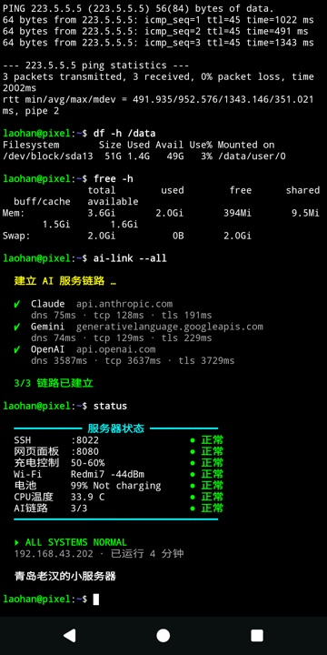
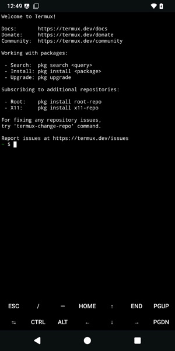

# pixel2xl-server

A Google Pixel 2 XL (taimen, Snapdragon 835) set up as an always-on LAN mini server. It runs LineageOS 22.2 (Android 15) with Magisk v30.7 and Termux.

This repo is separate from `redmi-note2-server`. The Termux dashboard and boot-intro files started as copies from that repo and are now maintained here on their own.

- **Dashboard**: http://192.168.43.202:8080, public at **https://pixel.tomexp.com** (Cloudflare tunnel `pixel`). The pages are server status, market quotes (same as the Redmi's 老汉移动信息网), and **每日新闻**. Every day at 07:00 local time it fetches 20 headlines each for world, China, Korea, Japan, Vietnam and Europe (with links, from Google News RSS) and saves them as a stand-alone page `~/news/<date>.html`. The menu shows a list by date. Each day is marked as generated / partly failed / failed (with the error) / not generated yet, and opens that day's page.
- **SSH**: `ssh -p 8022 192.168.43.202` (Termux, key auth)
- **Charge limiter**: the battery stays between 50% and 60%
- **Boot animation**: custom picture, LOADING progress bar and boot sound
- **Boot intro**: after boot, Termux opens full screen and runs a status board

## Screenshots

| Boot animation (progress bar + sound) | Boot intro status board | Termux first run |
|---|---|---|
|  |  |  |

**Boot sound:** [assets/audio/phone_boot.mp3](assets/audio/phone_boot.mp3) (11 s, packed into the boot animation as `part0/audio.wav`)

## Layout

```
magisk/service.sh           Magisk service.d entry -> /data/adb/service.d/pixelsrv.sh
magisk/phonectl.sh          charge limiter (battery/charging_enabled) + root-only info JSON
magisk/termux-services.sh   supervises sshd + dashboard as uid 10207 via Magisk su
magisk/termux-intro.sh      opens Termux with ~/bin/boot-intro after boot
magisk/bootsound.sh         post-fs-data.d hook that makes the boot sound actually play
termux/webstat/             dashboard (Python stdlib server + one HTML page)
termux/bin/boot-intro       typed commands, AI endpoint handshakes, status board
termux/dot-termux/          termux.properties (full screen, no keyboard, external apps)
tools/build_bootanim.sh     W=1440 H=2880 tools/build_bootanim.sh pic.png out.zip sound.mp3
deploy.sh                   root | bootanim | web | all | status
assets/                     boot picture + boot sound
docs/build-guide.html       full guide
```

**Full step-by-step guide (Chinese, commands explained):** [docs/build-guide.html](docs/build-guide.html)

## Assets

- `assets/images/bootanim-v2-portrait.png`: boot animation picture. It is fitted to 1440x2880 by `tools/build_bootanim.sh`.
- `assets/audio/phone_boot.mp3`: the boot sound.
- `docs/img/`: real-device screenshots used by the guide.

Not in git: the LineageOS zip, boot images, Magisk/Termux APKs, backups and the generated `bootanimation-pixel.zip`. All of these live on `/Volumes/SSD1G/download/pixel2xl-lineage/`. The guide lists the download URLs, and the zip is rebuilt from `assets/`.

## Deploy

```bash
./deploy.sh root       # USB + adb root: Magisk scripts into /data/adb (next boot)
./deploy.sh bootanim   # USB: adb remount, write /product/media/bootanimation.zip
./deploy.sh web        # SSH: dashboard, boot intro, Termux settings
```

## Differences from the Redmi

| | Redmi Note 2 (Android 7) | Pixel 2 XL (Android 15) |
|---|---|---|
| SELinux | permissive | **enforcing** |
| background services | custom init `.rc` services | Magisk `service.d` (root) + `su 10207 -g 10207 -G 3003` |
| charge control | `/proc/mtk_battery_cmd/current_cmd` | `battery/charging_enabled`, re-asserted because the charger HAL resets it |
| boot animation | `/system/media` | `/product/media`, written via `adb remount`, because Magisk modules mount too late |
| first boot screen | `logo` partition, editable | drawn by the signed bootloader (abl/xbl), **not editable** |

## Device quirks

- **Magisk installed from the command line** (boot patched with `boot_patch.sh`): you must populate `/data/adb/magisk` with the binaries yourself. Otherwise Magisk skips the post-fs-data and service stages, and no modules or `service.d` scripts run.
- **SELinux labels**: files that Magisk su creates in Termux's home get the bare `s0` label, and the Termux app then cannot load them (`CANNOT LINK ... libncursesw.so.6`). `termux-services.sh` fixes this at every boot with `chcon -R -h ...:c207,c256,c512,c768`. The `-h` matters: without it, symlink labels are not changed.
- **pgrep cannot see sshd from the Termux app**, because sshd runs in Magisk's SELinux domain. The boot intro checks the port instead.
- **Boot sound is blocked by sepolicy**: `avc: denied { find } ... scontext=u:r:bootanim:s0 tcontext=u:object_r:audio_service:s0`. `bootsound.sh` grants that one lookup with `magiskpolicy --live`, waits for the audio service, then restarts bootanim once. The audio player then takes about 10 s to come up, so boot takes longer.
- Stock LineageOS boot animation backup: `/Volumes/SSD1G/download/pixel2xl-lineage/backup/`. The stock boot image and the Magisk-patched boot image are kept there too.

## License

Code, docs, the boot picture and the boot sound (an original recording) are MIT-licensed. See [LICENSE](LICENSE).
